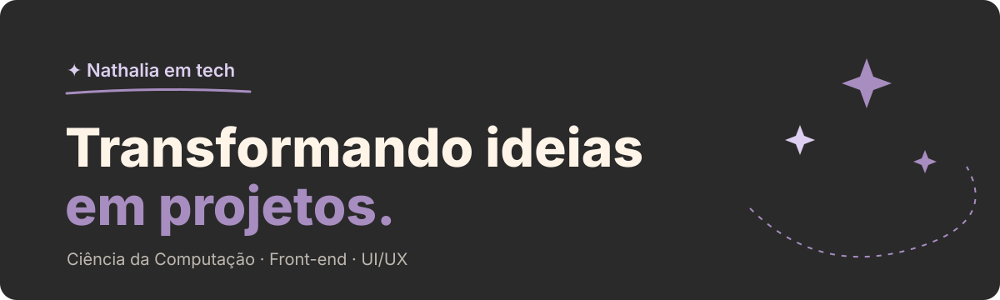

### ✦ Oi, eu sou a Nathalia

Estudante de Ciência da Computação construindo meu espaço na tecnologia — um projeto de cada vez.
Gosto de front-end, design de interfaces e de transformar ideias soltas em coisas que funcionam.

Este perfil é meu diário de construção: projetos, experimentos e o que aprendo no caminho.

 

### ✦ No que estou trabalhando

- 🍻 **[Saideira](https://github.com/nathalia0ferreira/saideira)** — PDV para bares de eventos: vendas, caixa, estoque e comandas
- 💸 **[Nexo](https://github.com/nathalia0ferreira/Nexo)** — gerenciador financeiro
- 🖼️ **[AfroMuseu](https://github.com/nathalia0ferreira/AfroMuseu)** · 🔁 **[Ciclo](https://github.com/nathalia0ferreira/Ciclo)** · 📖 **[Lume Literário](https://github.com/nathalia0ferreira/Lume-Literario)**

 

### ✦ Ferramentas

  

 

### ✦ Em números

  
  

 

✦ Transformando ideias em projetos ✦

